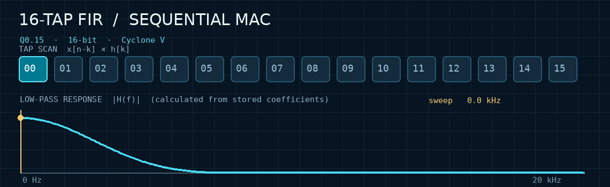
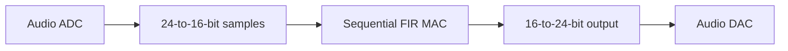
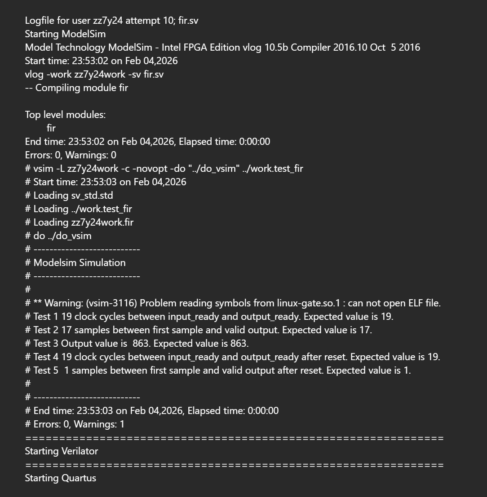
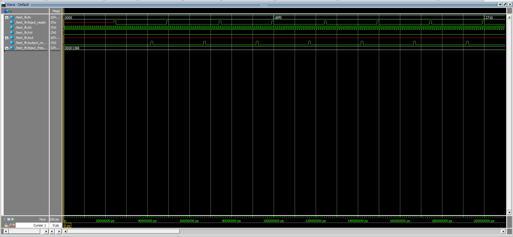
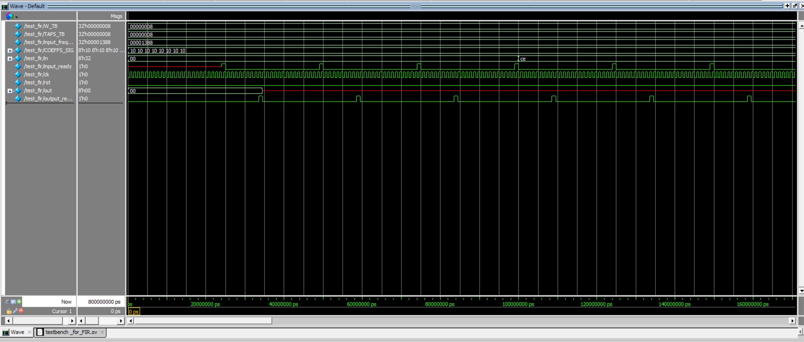
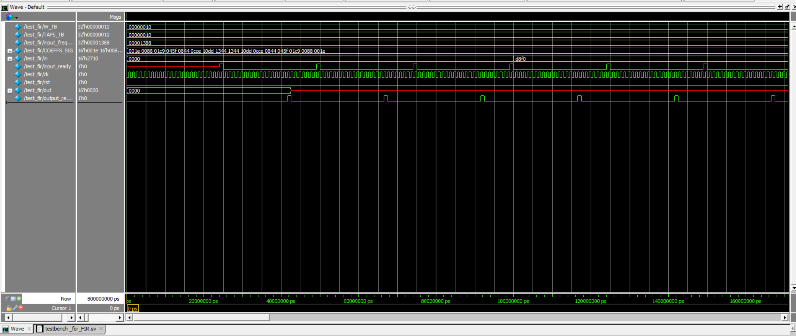
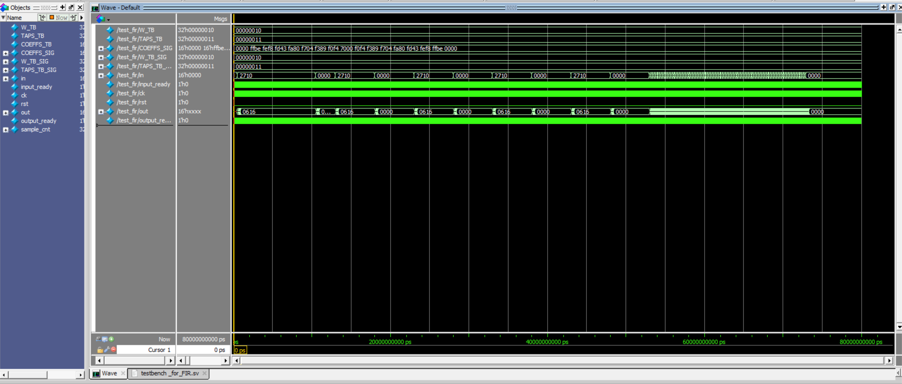
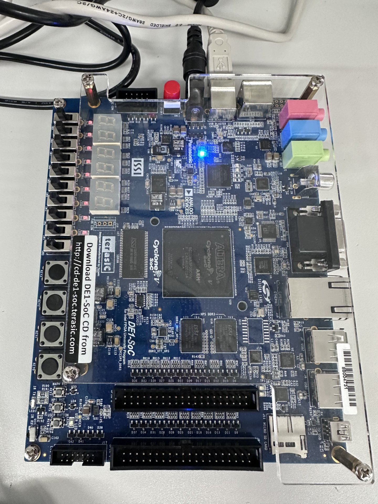
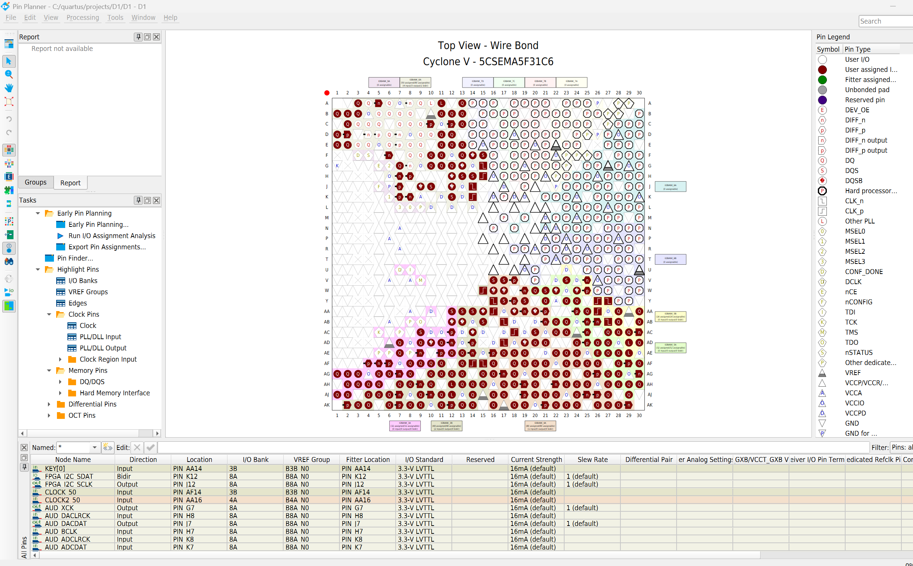

<div align="center">

# 16-Tap FIR Audio Filter on DE1-SoC




*Illustrative animation computed from the 16-tap coefficients — not a ModelSim measurement.*

[**English**](#english) · [**中文**](#中文) · [**RTL Code**](rtl/) · [**Screenshots**](docs/images/) · [**Code screenshots**](docs/code-screenshots/)

</div>

## English

### Overview

A **16-tap, 16-bit low-pass FIR** using one sequential multiply-accumulate (MAC) datapath and a four-state controller. Simulated in **ModelSim** and developed for the **DE1-SoC / Cyclone V** using **Quartus**. Additional **parameterized 8/16-tap** and **17-tap high-pass** versions are included.

### Architecture



| Item | Value |
| --- | --- |
| Default filter | 16-tap low-pass; signed 16-bit samples |
| Coefficients | Signed Q0.15, symmetric 16 taps |
| Hardware | Shift register + sequential MAC + 4-state FSM |
| Sample handshake | `input_ready` / `output_ready` |
| Reported checker timing | 19 clock cycles; 17 samples to first valid output |
| Reported checker value | 863 (matched expected value) |
| Extensions | 8-bit / 8-tap example; 17-tap high-pass |
| Audio integration | Stereo channels, 24-bit codec data mapped to 16-bit FIR |

### Test evidence



The supplied checker screenshot reports **0 compile errors**, the expected **19-cycle handshake timing**, **17-sample cold start**, output value **863**, and reset timing. One ModelSim shared-library warning appears in the simulation log.

<details><summary>ModelSim waveforms</summary>

**Default 16-tap FIR**



**Parameterized 8-bit and 16-bit tests**





**17-tap high-pass extension**



</details>

<details><summary>DE1-SoC / Quartus evidence</summary>





</details>

### Source & run

```text
rtl/                  fir.sv | fir_param.sv | fir_highpass.sv
tb/                  tb_fir.sv
sim/                  run.sh | run.do
fpga/DE1-SoC/         D1.sv | D1.qpf | D1.qsf
assets/               FIR animation
docs/                Evidence, original templates, code screenshots
```

Run with **ModelSim/Questa** or **Synopsys VCS**:

```bash
./sim/run.sh lowpass
./sim/run.sh param16
./sim/run.sh param8
./sim/run.sh highpass
```

Open `fpga/DE1-SoC/D1.qpf` in Quartus. For CODEC compilation, add the original vendor Audio Core `.v` modules from your licensed DE1-SoC course/Intel distribution and register them as Verilog files in the Quartus project. The reconstructed `D1.sv` connects two FIR instances to the stereo audio path. **The screenshot-derived sources and the new self-checking testbench have not been rerun here on commercial EDA tools.**

---

## 中文

### 项目简介

在 **DE1-SoC（Cyclone V）** 上设计 **16-tap、16-bit 低通 FIR**，采用顺序乘累加（MAC）、移位寄存器和四状态 FSM。使用 **ModelSim** 仿真与 **Quartus** 开发，并包含 **8/16-tap 参数化版本**及 **17-tap 高通扩展**。

### 核心参数

| 项目 | 内容 |
| --- | --- |
| 默认滤波器 | 16 阶抽头低通，16 位有符号输入 |
| 系数 | 对称 Q0.15 定点系数 |
| 控制 | `input_ready`、`output_ready`，四状态 FSM |
| 自动检查记录 | 延迟 19 时钟周期；冷启动首个有效输出等待 17 个采样 |
| 数值检查记录 | 输出 863，与预期一致 |
| 参数化扩展 | 8-bit / 8-tap 示例；17-tap 高通版本 |
| 音频接口 | 立体声 CODEC：24-bit 音频 ↔ 16-bit FIR |

### 验证与截图

上方 **Test evidence** 为原始自动检查结果；展开 **ModelSim waveforms** 可查看低通、参数化和高通波形，展开 **DE1-SoC / Quartus evidence** 可查看开发板及引脚规划图。

### 代码与运行

```bash
./sim/run.sh lowpass   # 16-tap 低通
./sim/run.sh param16   # 参数化 16-bit
./sim/run.sh param8    # 参数化 8-bit
./sim/run.sh highpass  # 17-tap 高通
```

`rtl/` 保存恢复后的完整 SystemVerilog 实现，`tb/` 保存新编写的自检 Testbench，`fpga/DE1-SoC/D1.sv` 保存从图片恢复的双通道音频 FIR 顶层。原始截图放在 `docs/code-screenshots/`。第三方音频 IP 需要通过合法的 DE1-SoC 工具包获取后加入 Quartus。


---

<sub>Educational engineering portfolio · 2026 · [Lugu200510](https://github.com/Lugu200510)</sub>
