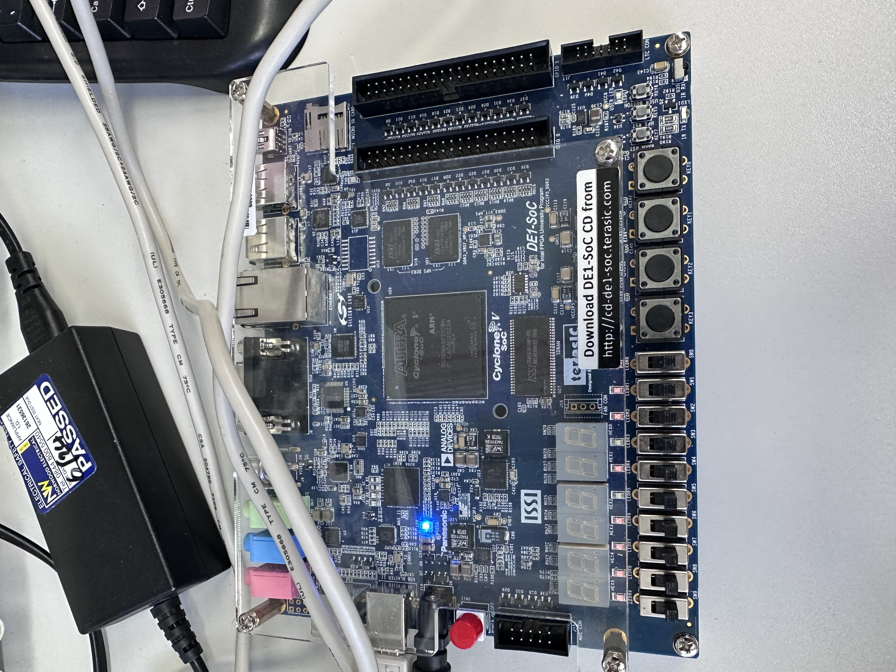

# DE1-SoC 16 抽头 FIR 音频滤波器

本项目使用 SystemVerilog 实现一个面向 DE1-SoC FPGA 的 16 抽头 FIR 低通数字滤波器，并通过顶层模块连接左右声道 FIR 与音频 CODEC，实现立体声音频数据的读取、滤波和写回。

## 主要功能

- 16 抽头、16 位有符号 FIR 低通滤波器
- 使用 Q0.15 定点滤波系数
- 采用顺序 MAC 架构，复用乘法器和累加器完成 16 次乘加运算
- 使用 `waiting`、`loading`、`processing`、`saving` 四状态 FSM 控制数据处理流程
- 支持左右声道 FIR 并行处理
- 24 位 CODEC 音频数据与 16 位 FIR 数据之间进行位宽转换
- 通过 `read_ready/read` 和 `write_ready/write` 完成音频数据握手
- 面向 DE1-SoC / Cyclone V FPGA 平台

## 文件说明

### `fir.sv`

16 抽头 FIR 核心模块，主要包含：

- 16 级采样延迟线
- 16 个 Q0.15 FIR 系数
- 4 位抽头地址计数器
- 32 位有符号累加器
- 顺序乘加数据通路
- 四状态 FSM
- 16 位滤波结果输出及 `output_ready` 握手信号

FIR 计算公式为：

```text
y[n] = h[0]x[n] + h[1]x[n-1] + ... + h[15]x[n-15]
```

### `D1.sv`

系统顶层集成模块，主要完成：

- Audio CODEC 接口连接
- 左右声道 24 位采样读取
- 24 位音频数据转换为 16 位 FIR 输入
- 同时启动左右两个 FIR
- 等待 FIR 处理完成并捕获输出
- 将 16 位 FIR 输出重新对齐为 24 位音频数据
- 等待 `write_ready` 后将结果写回 CODEC
- 连接 I2C 配置模块和音频主时钟生成模块

## 数据处理流程

```text
Audio CODEC ADC
      |
      v
24-bit Left / Right Samples
      |
      v
取 [23:8] 转为 16-bit signed
      |
      +-------------------+
      |                   |
      v                   v
 Left FIR              Right FIR
 16 taps                16 taps
      |                   |
      +-------------------+
      |
      v
16-bit FIR Results
      |
      v
左移 8 位重新对齐为 24-bit
      |
      v
Audio CODEC DAC
```

## FIR 控制流程

```text
waiting
   |
   | input_ready
   v
loading
   |
   v
processing
   |
   | 16 次顺序 MAC
   v
saving
   |
   | output_ready
   v
waiting
```

## 设计特点

顺序 MAC 架构在多个时钟周期内复用乘法和累加资源，相比 16 路完全并行 FIR 可以减少 FPGA DSP 和逻辑资源占用，但会增加处理延迟并降低吞吐率，体现了资源占用与性能之间的权衡。

左右声道分别实例化一个 `fir` 模块，因此左右声道之间并行处理，而单个 FIR 内部的 16 个抽头采用顺序方式完成计算。

## 开发工具与平台

- SystemVerilog
- ModelSim
- Intel Quartus Prime
- DE1-SoC
- Cyclone V FPGA

<p align="center">
  
</p>

<p align="center">
  <em>DE1-SoC Development Board</em>
</p>

## 使用说明

1. 将 `fir.sv` 和 `D1.sv` 加入 Quartus 工程。
2. 将 `D1` 设置为 Top-Level Entity。
3. 根据 DE1-SoC 工程加入对应的引脚约束。
4. 添加本项目依赖的音频支持模块。
5. 编译工程并完成 FPGA 配置。
6. 连接音频输入/输出设备进行功能验证。

## 依赖说明

`D1.sv` 还实例化了以下模块：

```text
clock_generator
audio_and_video_config
audio_codec
```

本仓库当前仅包含本次整理的 `fir.sv` 与 `D1.sv`。如需完整编译，必须另外提供上述依赖模块及相应 DE1-SoC 引脚配置文件。

如果这些依赖文件来自课程、教材或第三方工程，请先确认其许可范围，再决定是否公开上传到 GitHub。

## 说明

本项目用于展示 FPGA 数字信号处理、RTL 设计、有限状态机、定点运算以及音频接口集成实践。
